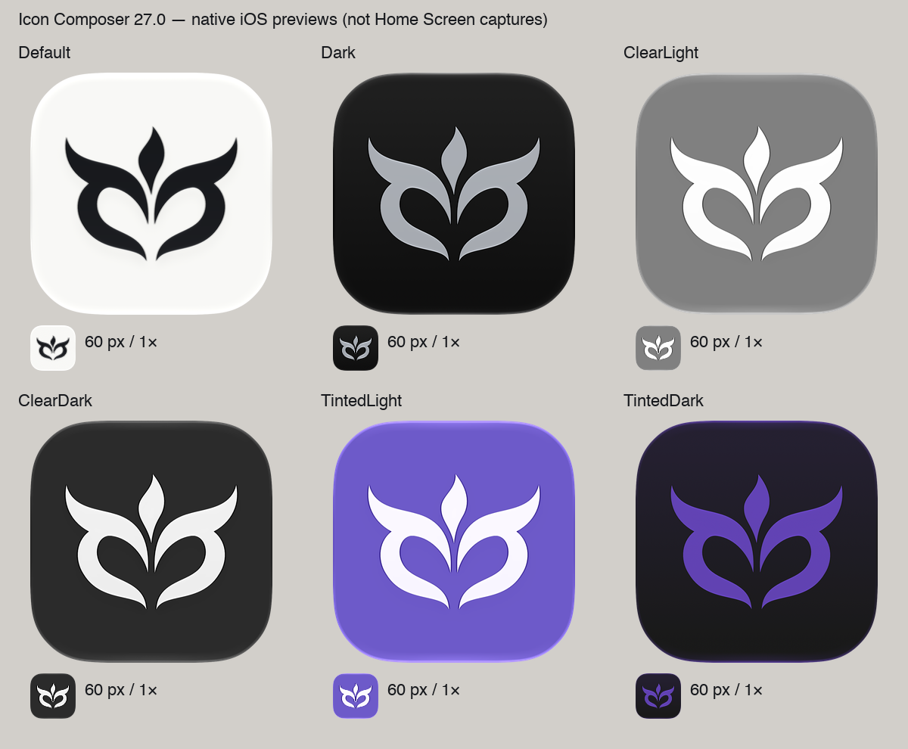

# Owl Phoenix app icon (JOG-29)

## Sources and treatment

- `OwlPhoenix.svg` preserves the canonical artwork supplied in JOG-29.
- `../../Joghd/Resources/AppIcon.icon` is the editable Icon Composer document.
  Open it with Xcode → Open Developer Tool → Icon Composer.
- Its single foreground uses the original path data and mirrored `<use>`;
  no tip rounding, negative-space edits, or face/flame separation were made.
  A uniform `0.96` scale and `(102.08, 175.04)` translation center the artwork
  on a square 1024 px canvas. The flame and lower tips have about 227 px of
  vertical padding; the face tips have about 153 px of horizontal padding.
- Default: opaque warm white `#F7F7F5` with graphite `#17191D` artwork.
  Dark: graphite background with silver `#A8ADB5` artwork. Mono uses white
  artwork; the system derives clear and tinted light/dark appearances.
- Source shapes are opaque and flat. Icon Composer supplies specular lighting,
  10% translucency and a 15% neutral shadow. There are no baked bevels, shadows,
  gradients, highlights, masks, or rounded corners in the source artwork.

## Integration and older systems

XcodeGen already includes everything under `Joghd/`. It recognizes the `.icon`
package as a resource and passes it to `actool` alongside `Assets.xcassets`.
The unchanged `ASSETCATALOG_COMPILER_APPICON_NAME: AppIcon` selects it.
`project.yml` still specifies iOS **17.0**; no application code changes.

Apple's current documentation says the selected Icon Composer document replaces
the same-named catalog icon, and Xcode generates static backward-compatible
images from it. Therefore, the installed iOS 18.4 icon is **Xcode's flattened
rendition**, not a claim that the manually supplied PNG wins over `.icon`.
The complete `AppIcon.appiconset` also contains opaque, square 1024 px default,
dark and tinted PNGs with the same composition, for catalog-only workflows.
No parent-directory artwork or asset generation is required for an app build.

CI now pins Xcode **26.3** (available on GitHub's `macos-15` runner) rather than
16.4, which predates Icon Composer. The existing iOS 18.5 test destination
continues to exercise backward compatibility. Local validation used Xcode 27.

To regenerate the committed flat catalog PNGs and square foreground from the
canonical SVG (maintenance only, not part of the app build):

```sh
python3 -m venv /path/to/icon-venv
/path/to/icon-venv/bin/pip install cairosvg==2.9.1
DYLD_FALLBACK_LIBRARY_PATH=/opt/homebrew/lib \
  /path/to/icon-venv/bin/python docs/app-icon/generate-fallback.py
```

CairoSVG needs Cairo installed (`brew install cairo` on macOS).

## Validation — 2026-10-11

Toolchain: Xcode **27.0 (27A266a)**, Icon Composer **27.0 (129)**,
XcodeGen **2.46.0**. Simulators: iOS **27.0 (24A434)** / iPhone 18 Pro,
iOS **18.4 (22E238)** / iPhone 16e.

- Generated project and simulator build succeeded, with no icon compilation
  warnings or missing/invalid icon errors. The only build warning was the
  existing lack of an AppIntents framework dependency.
- Existing application test suite: **2 tests passed**.
- Installed app visibly displays the Owl Phoenix instead of the placeholder
  on both current and pre–Liquid Glass Home Screens.
- All six appearances were exported through Icon Composer at 1024 px and
  60 px. The comparison sheet below shows a 320 px overview plus each 60 px
  export at 1×. These are native renderer exports, **not installed screenshots**.
- Visual inspection confirms preserved face curves/flame, clear eye openings,
  balanced padding, and recognizable tips at Home Screen size. Default and
  dark have strong contrast; mono preserves the same silhouette. Native edge
  lighting is restrained, with no filled negative space or broad chrome bands.
- iOS 17 runtime and physical-device gyro/lighting checks were unavailable.
  iOS 18.4 verifies an older supported OS; built `MinimumOSVersion` is 17.0.
  Xcode 26.3 is CI-pinned but was not installed for local validation.



## Reproduce

```sh
xcodegen generate
xcodebuild -project Joghd.xcodeproj -scheme Joghd \
  -destination 'generic/platform=iOS Simulator' \
  -derivedDataPath build CODE_SIGNING_ALLOWED=NO build
xcodebuild -project Joghd.xcodeproj -scheme Joghd \
  -destination 'platform=iOS Simulator,id=YOUR_SIMULATOR_UUID' \
  -derivedDataPath build CODE_SIGNING_ALLOWED=NO test
xcrun simctl install YOUR_SIMULATOR_UUID \
  build/Build/Products/Debug-iphonesimulator/Joghd.app
xcrun simctl io YOUR_SIMULATOR_UUID screenshot home-screen.png
```

On the Home Screen, hold empty space → Edit → Customize to select Default,
Dark, Clear or Tinted. Clear/Tinted have Light and Dark options. Changing
`simctl ui ... appearance dark` alone does **not** select the dark icon.

Icon Composer 27's export command (use `Default`, `Dark`, `ClearLight`,
`ClearDark`, `TintedLight`, or `TintedDark`; use 60 for both sizes to check small
rendering):

```sh
"$(xcode-select -p)/../Applications/Icon Composer.app/Contents/Executables/ictool" \
  Joghd/Resources/AppIcon.icon --export-image --output-file preview.png \
  --platform iOS --rendition Default --width 1024 --height 1024 --scale 1
```

Older Icon Composer versions may use a different CLI; the GUI supports the
equivalent appearance previews/exports. Keep exports separate from production
source layers so static effects never feed back into the native document.

## Verified references

Read on 2026-10-11:

- [Apple app icon HIG](https://developer.apple.com/design/human-interface-guidelines/app-icons/)
  (guidance updated June 8, 2026): square unmasked layers, opaque full-bleed
  backgrounds, consistent identity, and system-applied effects.
- [Creating your app icon using Icon Composer](https://developer.apple.com/documentation/xcode/creating-your-app-icon-using-icon-composer):
  `.icon` target integration, backward-compatible generated icons, default/dark/
  mono annotations, and preview/export controls.
- [WWDC25: app icon design](https://developer.apple.com/videos/play/wwdc2025/220/)
  and [Icon Composer](https://developer.apple.com/videos/play/wwdc2025/361/):
  flat opaque SVG source, material refinement in Composer, six appearances.
- [GitHub macOS 15 runner image](https://github.com/actions/runner-images/blob/main/images/macos/macos-15-Readme.md):
  Xcode 26.3 availability and retained iOS 18.5 simulators.
